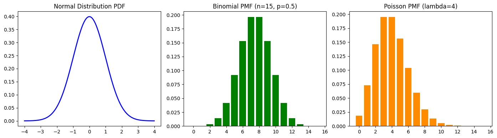

# probability-distributions-engine
## Project Overview
A Python-based mathematical and statistical simulation engine implementing core discrete and continuous probability distributions from scratch without relying on high-level statistical libraries.

## Objectives
* Implement theoretical Probability Density Functions (PDF) and Probability Mass Functions (PMF) from mathematical formulas.
* Simulate and compare Standard Normal, Binomial, and Poisson distributions.
* Visualize statistical behavior across varying parameters ($\mu, \sigma, n, p, \lambda$).

## Technologies Used
* Python
* NumPy (Vectorized Mathematical Operations)
* Matplotlib (Multi-panel Statistical Visualization)
* Math Library (Factorial & Combinatorics)

## Mathematical Formulations
* **Standard Normal PDF:** $f(x) = \frac{1}{\sqrt{2\pi}} e^{-\frac{1}{2}x^2}$
* **Binomial PMF:** $P(X=k) = \binom{n}{k} p^k (1-p)^{n-k}$
* **Poisson PMF:** $P(X=k) = \frac{\lambda^k e^{-\lambda}}{k!}$

## Data Visualization

### Theoretical Distribution Models

## Key Findings
* **Standard Normal ($\mu=0, \sigma=1$):** Demonstrates symmetric bell-curve density peaking at $f(0) \approx 0.3989$.
* **Binomial ($n=15, p=0.5$):** Exhibits symmetric discrete probability distribution centered at $k = 7$ and $k = 8$.
* **Poisson ($\lambda=4$):** Captures right-skewed discrete event probabilities peaking around the rate parameter $\lambda = 4$.

## Author
Shivam Malik

GitHub: https://github.com/shivamquantlab

## Conclusion
This project demonstrates how mathematical formulations of fundamental probability distributions can be translated into clean, vectorized Python code for quantitative and data science applications.
